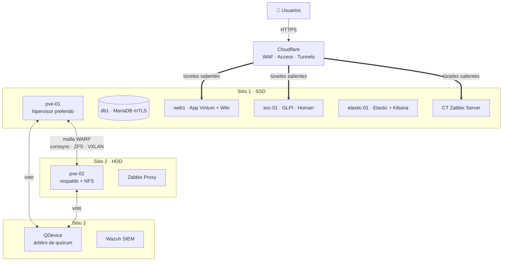

<div align="center">

# 🏗️ Vintum · Infraestructura multisitio de alta disponibilidad

### Clúster Proxmox entre 3 sitios con failover automático, observabilidad completa y respuesta a incidentes

*Proyecto de Gestión de Incidentes y Seguridad de Infraestructura: una empresa ficticia (Vintum) con su
aplicación web, sus servicios internos y su centro de operaciones, montada sobre hardware real en tres casas
distintas, sin IPs públicas y sin abrir un solo puerto en los routers.*


[Arquitectura](#️-arquitectura) · [Alta disponibilidad](#-alta-disponibilidad) · [Observabilidad](#-observabilidad-y-respuesta-a-incidentes) · [Seguridad](#-seguridad) · [Lecciones](#-incidentes-reales-y-lecciones) · [Guía](docs/guia-paso-a-paso.md)

</div>

---

## 🎯 El reto

Construir y operar la infraestructura completa de una empresa con requisitos de producción, pero con
restricciones muy reales:

- **Tres sitios** en redes domésticas distintas, todos detrás de **doble NAT** y sin IP pública.
- **Hardware modesto**: dos portátiles como hipervisores (uno con SSD, otro con HDD) y un tercer equipo como árbitro.
- Un enlace entre sitios de **~150 ms y ~4,5 MB/s**.
- Y aun así: **alta disponibilidad**, **monitoreo**, **mesa de ayuda con SLA**, **SIEM** y **cero puertos abiertos**.

## 📊 Resultados

| Qué | Resultado |
|---|---|
| Sitios unidos | **3**, por una malla Cloudflare WARP (sin VPN propia ni puertos abiertos) |
| Cargas protegidas por HA | **5** (BD, web, servicios, Elastic, Zabbix) con failover automático **probado con caídas reales** |
| Failover medido (nodo muerto) | Quórum en **31 s**, las 5 cargas arrancadas en **156 s**; pérdida de datos **≤ 43 s** |
| Replicación entre nodos | ZFS cada **5 min** (RPO ≤ 5 min) |
| Red de las VMs | **SDN VXLAN** estirada entre sitios: una VM conserva su IP corra en el nodo que corra |
| Detección → ticket → aviso | Zabbix/Kibana → **ticket automático en GLPI** → correo + **Telegram**, con cierre automático al resolverse |
| SLA de la mesa de ayuda | Crítico: respuesta 30 min / resolución 4 h · Normal: 2 h / 1 día |
| Verificación | **89 comprobaciones automáticas** de toda la plataforma (solo lectura) |
| Exposición | Solo la web pública; todo lo demás detrás de **Cloudflare Access** |

## 🏗️ Arquitectura



| Capa | Componentes |
|---|---|
| Virtualización | Proxmox VE 9 (2 nodos + QDevice), ZFS, replicación `pvesr`, HA Manager, SDN VXLAN |
| Red | Malla Cloudflare WARP Connector entre sitios, VXLAN VNI 100, rutas y gateway gestionados por un reconciliador |
| Aplicación | Vintum (Fastify + React) · MariaDB con **mTLS** · nginx con cabeceras de seguridad |
| Servicios | GLPI 11 (ITSM), Wiki.js, Homarr, Portainer |
| Observabilidad | Zabbix (server + proxy), Elasticsearch / Kibana 9.5, Filebeat, Heartbeat, colector de Cloudflare |
| Seguridad | Wazuh 4.9 (agentes en 7 hosts), Cloudflare Access + WAF, SSH solo con llave |
| Avisos | GLPI (correo), Cloudflare Worker + bot de Telegram |

Detalle: **[docs/arquitectura.md](docs/arquitectura.md)**

## ♻️ Alta disponibilidad

- **Quórum de 3 votos** con dos hipervisores y un **QDevice** (`corosync-qnetd`) en el tercer sitio: si un nodo cae, el otro sigue con mayoría y levanta las cargas.
- **Replicación ZFS cada 5 minutos** de las 5 cargas hacia el otro nodo y **HA Manager** con afinidad al nodo rápido, *fencing* por watchdog y **failback manual controlado** (script propio, nunca live-migration por el enlace lento).
- **SDN VXLAN** sobre la malla: las VMs conservan IP y gateway en cualquier nodo.
- **Reconciliador de red propio** (`vintum-ha-net.sh`, cada 30 s): decide qué nodo es líder y, solo si se cumplen **tres condiciones independientes**, toma el gateway del sitio caído. Nació de un incidente real (dos gateways a la vez).
- Timers de apoyo: limpieza de discos huérfanos de cloud-init, **arranque suave** de Elastic en el nodo con HDD, respaldos semanales con límite de ancho de banda para no ahogar a corosync.

Detalle y pruebas: **[docs/alta-disponibilidad.md](docs/alta-disponibilidad.md)**

## 🚨 Observabilidad y respuesta a incidentes

```
Zabbix (métricas, escenarios web)  ─┐
Kibana (nginx, SSH, Heartbeat, WAF y Access de Cloudflare) ─► índice de alertas ─► Zabbix ─► ticket en GLPI
                                                                                     ├► correo al equipo
                                                                                     └► Telegram (aunque GLPI esté caído)
```

- **Kibana**: dashboards de operación, de Cloudflare y de la malla, generados como código (`gen_dashboard_*.py`), y reglas de detección (fuerza bruta web y SSH, ráfagas en el WAF, accesos denegados, túneles caídos).
- **Zabbix**: server + proxy por sitio, escenarios web, latencia de la malla y desfase de reloj.
- **GLPI**: tickets automáticos con categoría y SLA, cierre automático al resolverse y espejo en Elastic.
- Proceso basado en **NIST SP 800-61**: tomar → analizar → contener → verificar → documentar.

Detalle: **[docs/observabilidad.md](docs/observabilidad.md)**

## 🔒 Seguridad

| Área | Medidas |
|---|---|
| Exposición | Cero puertos abiertos; cada servicio sale por su propio Cloudflare Tunnel; un solo conector por túnel |
| Acceso | Cloudflare Access en todos los paneles y en SSH; consolas de Proxmox por un conector propio de cada hipervisor |
| Aplicación | **2FA por correo obligatoria**, sesiones opacas de 256 bits (sin JWT), CSRF, respuestas idénticas para evitar enumerar cuentas, saneamiento de URLs (SSRF/XSS) |
| Base de datos | MariaDB con **TLS mutuo** y usuarios restringidos por IP |
| Hosts | SSH solo con llave en 8 equipos, `MaxAuthTries 3`, contraseñas aleatorias por nodo |
| Borde | SSL estricto, HSTS con subdominios, SPF + DMARC `reject` + CAA, cabeceras COOP y Permissions-Policy |
| SIEM | Wazuh con credenciales de fábrica rotadas, API e indexer solo en localhost, reglas locales para ruido |
| Verificación | Escáner propio (`seguridad/scan_vintum.py`): cabeceras, enumeración de cuentas, bypass de 2FA, SSRF/XSS |

Detalle: **[docs/seguridad.md](docs/seguridad.md)**

## 🔥 Incidentes reales y lecciones

La parte más valiosa del proyecto: la infraestructura se **cayó de verdad** varias veces y cada caída dejó una
mejora documentada. Algunos ejemplos:

| Incidente | Causa raíz | Qué cambió |
|---|---|---|
| Web caída ~5,5 h **sin aviso** | Un parpadeo de ~45 s de la malla dejó al nodo sin quórum y el watchdog lo reinició; después HA intentó devolver las cargas en caliente por un enlace que no lo permite. No hubo aviso porque las alertas dependían de GLPI y vivían en el nodo caído | Telegram siempre (con cola de tickets), vigilante externo en Cloudflare cada minuto, guardia de líder y retorno manual |
| El failover no levantó nada | El servicio del QDevice llevaba 14 h muerto sin que nadie lo notara | `Restart=always` + monitoreo del QDevice |
| Un ajuste de corosync reinició un nodo | `token` demasiado alto frente al watchdog fijo de 60 s de HA | Regla documentada: `token + consenso` muy por debajo del watchdog |
| Bucle de migraciones de 20 h | `failback=1` con un enlace que no permite migrar en caliente | `failback=0` y script de failback manual |
| Toda la LAN sin red | Dos nodos anunciando el mismo gateway → ARP envenenado | Reconciliador con tres candados |
| Tickets que nunca llegaban | El script de alertas corría en un nodo que no alcanzaba GLPI | Reenvío por el otro nodo + cola con reintentos |

Todas, con línea de tiempo y lección: **[docs/incidentes-y-lecciones.md](docs/incidentes-y-lecciones.md)**

## 📁 Estructura

```
vintum-infra/
├── proxmox/                Conector de Cloudflare por hipervisor, rutas de la malla, ejemplos de VMs
├── alta-disponibilidad/    Reconciliador de red, failback, timers de apoyo, alertas a GLPI/Telegram
├── observabilidad/
│   ├── elastic/ kibana/    Stack Elastic, dashboards y reglas de detección como código
│   ├── filebeat/ heartbeat/  Recolección de logs y disponibilidad por host
│   ├── zabbix/             Hosts, triggers, escenario web y media type → GLPI
│   └── cloudflare-collector/  Eventos del WAF, Access y túneles hacia Elastic
├── servicios/              GLPI (+ espejo en Elastic), Homarr, Wiki.js, agente de Portainer
├── app/                    Extractos de seguridad de la app: autenticación, 2FA, sesiones, nginx
├── seguridad/              Escáner de seguridad propio
└── docs/                   Arquitectura, HA, observabilidad, seguridad, incidentes y guía paso a paso
```

> Los archivos son **copias reales** de la configuración en producción, limpiadas de secretos: todas las
> credenciales se leen de variables de entorno o archivos con permisos `600` que no forman parte del repositorio.

## 📘 Guía paso a paso

**[docs/guia-paso-a-paso.md](docs/guia-paso-a-paso.md)**: cómo montar la plataforma desde cero, en el mismo orden
en que se construyó, explicando en cada fase *qué se hace*, *por qué* y *cómo comprobarlo*.

## 👥 Equipo y cómo se construyó

Proyecto académico desarrollado **en equipo de tres personas** para la asignatura de Gestión de Incidentes y
Seguridad de Infraestructura. Este repositorio recopila la configuración técnica de la plataforma.

Lo desarrollamos **trabajando con IA** (Claude Code, de Anthropic) como compañero de trabajo: nosotros
definimos la arquitectura, operamos los equipos, ejecutamos las pruebas de caída y tomamos las decisiones; la IA
ayudó a escribir scripts y documentación, a diagnosticar incidentes y a revisar configuraciones. Todo se
ejecutó y validó sobre hardware real.

## 🧰 Stack

Proxmox VE · ZFS · Corosync / QDevice · HA Manager · SDN VXLAN · Cloudflare (Tunnel, WARP Connector, Access,
WAF, Workers) · Docker · MariaDB · Node.js (Fastify) · React · nginx · Elasticsearch · Kibana · Filebeat ·
Heartbeat · Zabbix · Wazuh · GLPI · Wiki.js · Homarr · Portainer · Bash · Python

---

<details>
<summary><b>🇬🇧 English summary</b></summary>

**Vintum** is a multi-site, highly available infrastructure built on real consumer hardware across three homes
behind double NAT, with no public IPs and no open ports. Two Proxmox VE nodes plus a corosync QDevice form a
3-vote cluster joined by a Cloudflare WARP mesh (~150 ms, ~4.5 MB/s); five critical workloads are protected
by ZFS replication every 5 minutes and HA Manager, on a VXLAN SDN stretched across sites so VMs keep their
IPs on any node. A custom reconciler manages routes and gateway ownership with three independent safety
checks. Observability combines Zabbix (server + proxy), Elastic/Kibana with detection rules as code,
Heartbeat and a Cloudflare collector; alerts automatically open GLPI tickets with SLAs and notify by email
and Telegram. Security includes Cloudflare Access on every panel, mandatory email 2FA in the app, MariaDB
with mutual TLS, key-only SSH and Wazuh. Real outages were documented with root causes and fixes. Team
project of three, built with an AI pair-programmer (Claude Code) as a coworker.

</details>

<div align="center">

[@diriartev](https://github.com/diriartev) · Licencia [MIT](LICENSE)

</div>
